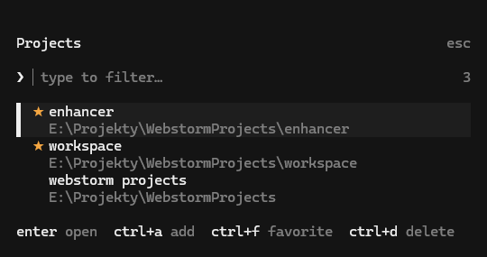

# opencode-cdf

An OpenCode TUI plugin for saving project directories and switching between them with `/cdf`.

> Supports OpenCode V2 only (built against `@opencode/plugin` 2.0.26). V1 is not supported.

<p align="center">
  
</p>

## Features

- Project picker with a type-to-filter prompt, a match counter, and two-line cards (name and path).
- Favorites listed first with a `★`; the project of the current session is marked `current`.
- Filtering by name, full path, or the shortened `~/…` path.
- Add, remove, and toggle-favorite actions without leaving the picker.
- Mouse support: hover, click to open, and wheel scrolling.
- Colors come from the active OpenCode theme, so light and dark themes both work.
- Moves the current session with the V2 `session.move` API, or opens a new session from the Home screen.

## Requirements

- OpenCode V2 2.0.26 or newer.

## Install

Install the plugin from GitHub with the OpenCode CLI:

```sh
opencode plugin add github:igorovh/opencode-cdf
```

To pin a release, add its tag:

```sh
opencode plugin add github:igorovh/opencode-cdf#v0.1.0
```

This adds the plugin to the global `plugins` array in `~/.config/opencode/opencode.jsonc`. Restart the TUI, then run
`/cdf`.

You can also add the entry to the config yourself:

```jsonc
{
  "$schema": "https://opencode.ai/config.json",
  "plugins": ["github:igorovh/opencode-cdf"]
}
```

Update or remove it later:

```sh
opencode plugin update github:igorovh/opencode-cdf
opencode plugin remove github:igorovh/opencode-cdf
```

## Usage

Run `/cdf` or choose **Change directory favorite** from the command palette (`Ctrl+P`).

| Key           | Action                                                         |
| ------------- | -------------------------------------------------------------- |
| typing, paste | Filter projects                                                |
| `↑` / `↓`     | Move the selection                                             |
| `Enter`       | Open the selected project                                      |
| `Ctrl+A`      | Add a project by entering its path, display name, and favorite |
| `Ctrl+F`      | Toggle the favorite star on the selected project               |
| `Ctrl+D`      | Remove the selected project after confirmation                 |
| `Esc`         | Close the picker                                               |

The selection stays on the same project after adding, toggling, or removing one. The shortcuts are active only while
the picker is open.

Selecting a project while viewing a session moves that session to the selected directory. Selecting a project from
Home creates a new session in that directory. The plugin never calls `process.chdir` and never sends a prompt to the
model.

Relative paths entered during the add flow are resolved from the active session directory. `~` is expanded to the
current user's home directory. A path must exist and must be a directory before it can be saved or opened.

## Development

Requires [Bun](https://bun.sh).

```sh
git clone https://github.com/igorovh/opencode-cdf.git
cd opencode-cdf
bun install
bun test
bun run typecheck
```

To run your checkout instead of the published plugin, put its path in `plugins` and restart the TUI:

```jsonc
{
  "plugins": ["/path/to/opencode-cdf"]
}
```

## License

[MIT](LICENSE)
