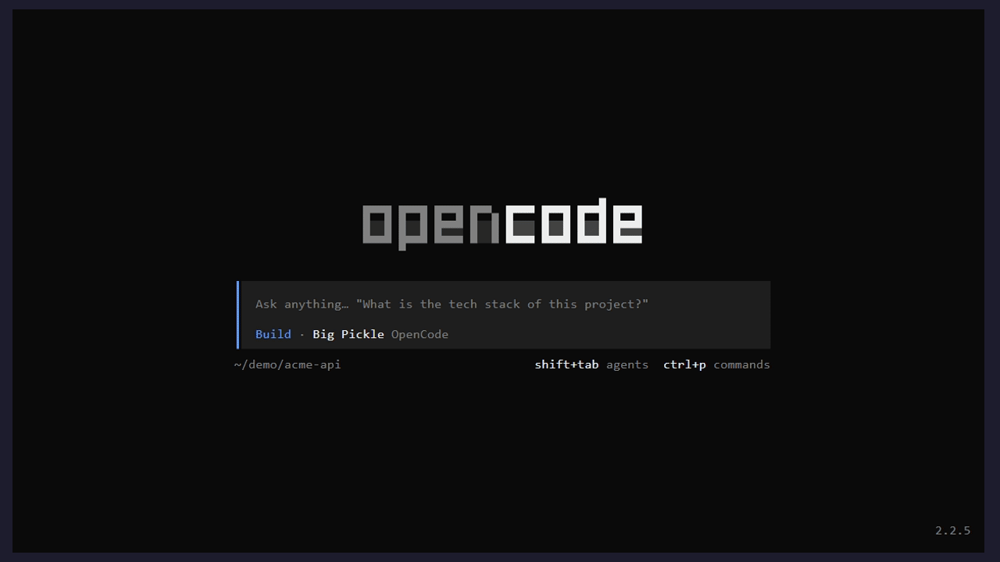

# opencode-cdf

A plugin for the [OpenCode](https://opencode.ai) TUI (v2) that keeps a list of your project directories. Run `/cdf`,
pick a project, and the current session moves there. From the Home screen it opens a new session instead.

> Supports OpenCode V2 2.2.5 or newer. V1 is not supported.

<p align="center">
  
</p>

The demo shows, in order: opening `/cdf`, moving with the arrow keys, starring a project with `ctrl+f`, adding a
project with `ctrl+a`, and filtering by typing, then opening the match in a new session.

## Features

- **Project picker** with a type-to-filter prompt, a match counter, and two-line cards (name and path).
- **Favorites** are listed first with a `★`. The project of the current session is marked `current`.
- **Filtering** by name, full path, or the shortened `~/…` path.
- **Add, remove, and toggle favorites** without leaving the picker.
- **Mouse support:** hover, click to open, and wheel scrolling.
- **Theme colors** come from the active OpenCode theme, so light and dark themes both work.
- **Shared list:** every open OpenCode window sees the same projects.

## Requirements

- OpenCode V2 2.2.5 or newer.

## Install

Install the plugin from GitHub with the OpenCode CLI. Pin a release tag: OpenCode then caches that exact version and
can tell when a newer one is out.

```sh
opencode plugin add github:igorovh/opencode-cdf#v0.2.1
```

This adds the plugin to the `plugins` array in `~/.config/opencode/cli.json`. Restart the TUI, then run `/cdf`.

You can also add the entry to the config yourself:

```jsonc
{
  "$schema": "https://opencode.ai/v2/cli.json",
  "plugins": ["github:igorovh/opencode-cdf#v0.2.1"]
}
```

Update or remove it later:

```sh
opencode plugin update github:igorovh/opencode-cdf
opencode plugin remove github:igorovh/opencode-cdf
```

## Keys and commands

Run `/cdf` or choose **Change directory favorite** from the command palette.

| Key | Command ID | Action |
|---|---|---|
| typing, paste | | Filter projects |
| `↑` / `↓`, `ctrl+p` / `ctrl+n` | | Move the selection |
| `enter` | | Open the selected project |
| `ctrl+a` | `cdf.add` | Add a project: path, display name, and favorite |
| `ctrl+f` | `cdf.favorite` | Toggle the favorite star on the selected project |
| `ctrl+d` | `cdf.remove` | Remove the selected project after confirmation |
| `esc` | | Close the picker |

The shortcuts work only while the picker is open. The selection stays on the same project after you add, toggle, or
remove one.

Relative paths in the add flow are resolved from the active session directory, and `~` is your home directory. A path
must exist and be a directory before it can be saved or opened.

## Options

The plugin has no options of its own. To change a shortcut, set its command ID under `keybinds` in
`~/.config/opencode/cli.json`; the hints at the bottom of the picker follow your setting:

```jsonc
{
  "keybinds": { "cdf.add": "ctrl+o", "cdf.favorite": "ctrl+s" }
}
```

TUI plugins only get `options` from `cli.json`. If a later version adds options, put them on a `cli.json` entry whose
`package` is exactly the same string as the one you installed. `opencode plugin add` does not write options for you,
and options on an `opencode.jsonc` entry do not reach the TUI.

```jsonc
{
  "plugins": [{ "package": "github:igorovh/opencode-cdf#v0.2.1", "options": {} }]
}
```

## How it works

- Opening a project in a session calls the V2 `session.move` API. On the Home screen it creates a new session in that
  directory. The plugin never calls `process.chdir` and never sends a prompt to the model.
- The list is stored with OpenCode's plugin storage in
  `~/.local/state/opencode/<channel>/tui/plugin.cdf.projects.json`. Writes are atomic, and other open TUIs pick up
  changes.
- Saved paths are resolved to real paths, so a symlink and its target count as one project. Paths are compared
  without case on Windows and macOS.
- The repo ships a compiled `dist/tui.js`. OpenCode compiles Solid JSX only for files outside `node_modules`, and a
  `github:` install lives inside it
  ([anomalyco/opencode#39986](https://github.com/anomalyco/opencode/issues/39986)).

## Development

Requires [Bun](https://bun.sh).

```sh
git clone https://github.com/igorovh/opencode-cdf.git
cd opencode-cdf
bun install
bun test
bun run typecheck
bun run compile      # rebuild dist/tui.js; commit it with your change
bun run check:dist   # dist/ may only import modules OpenCode provides
```

To run your checkout instead of the published plugin, put its path in `cli.json` `plugins` and restart the TUI.
OpenCode loads `dist/tui.js`, so run `bun run compile` after every change.

```jsonc
{
  "plugins": ["/path/to/opencode-cdf"]
}
```

`docs/demo.tape` records the demo GIF with [VHS](https://github.com/charmbracelet/vhs) on Windows PowerShell:
`vhs docs/demo.tape`. `docs/demo-setup.ps1` gives OpenCode a fake home, config and project list, and the TUI runs
with `--standalone`, so the recording shows no personal data and does not touch the background service. Set
`OPENCODE_BIN` if `opencode` on your `PATH` is not OpenCode V2.

## License

[MIT](LICENSE)
